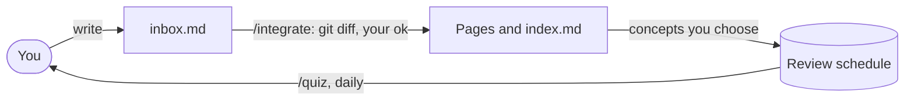

# Recall

**A git-native study system for Obsidian.**

You write what you learn in one inbox page. At the end of a study session, `/integrate` moves it into your vault's pages, block by block, and shows each change as a git diff for you to approve. An index records the concepts each page explains, and `/quiz` asks you up to 20 questions a day on those concepts, scheduled by spaced repetition (Anki's classic algorithm by default, and every number adjustable). A small Python script does the scheduling and all the git work; Claude writes, asks and judges; you approve.

- **Your words stay yours.** Claude moves and links what you wrote, and marks anything it adds.
- **Git is the backbone.** Each operation is one commit, so `git log` reads like a study journal and `git revert` undoes.
- **It fits any vault.** Paths, languages, exclusions and the scheduling algorithm live in one config file.

## How it works



- **Inbox.** One page you write in every day, one block per subject.
- **Index.** For each page, the concepts that page explains. It is how Claude finds where new notes belong without reading the whole vault, and the list of what can be quizzed.
- **Review schedule.** The concepts you chose to remember, each with the date from which it is due. The script computes every date; the model never does.
- **Seals.** `/maintenance` checks pages against the index and seals the ones that pass. Any change to a page breaks its seal.

## Requirements

- [Claude Code](https://code.claude.com/docs/en/overview)
- git
- Python 3.8 or later (standard library only)
- An Obsidian vault, or any folder of Markdown files

Recall targets macOS, Linux and WSL. Native Windows is untested.

## Install

In Claude Code, opened in your vault:

```text
/plugin marketplace add jeantotola/obsidian-recall
/plugin install recall@obsidian-recall
```

Choose the **project** scope, so Recall's commands and hook load only in this vault. Then run:

```text
/setup
```

`/setup` asks a few questions (the language to talk to you in, paths, exclusions, the scheduling algorithm), creates `.srs/`, the inbox and the index, and turns the vault into a git repository if it isn't one. Run `/setup` again until all your existing pages are indexed: each round indexes 20 pages with a small model, and you approve it by diff. Nothing enters the review schedule during setup.

## Quick manual

| Command | When | What it does |
| --- | --- | --- |
| `/integrate [n \| file]` | After studying | Moves inbox blocks into your pages, newest first, with one diff and one commit per block. Ends with one question: which concepts go into review. |
| `/quiz` | Every day | Up to 20 questions on the concepts that are due. Answer in your own words. |
| `/promote [page or topic]` | When you have time | Moves concepts that are only in the index into the review schedule. |
| `/maintenance` | Now and then | Checks the index and the pages, audits unsealed pages, and seals the ones that pass. |
| `/setup` | Once, then until indexed | Configures the vault and indexes existing pages. |

Commands work by their short name when nothing else uses it; otherwise type `/recall:quiz` and so on.

### A day with Recall

1. **Study and write.** Add blocks at the end of `inbox.md`, each starting with a `##` heading of a few words. A date in the heading is fine.
2. **Run `/integrate`.** For each block, Claude finds the related pages through the index, writes the change and shows you the git diff. Approve it, ask for a change, skip the block (it stays in the inbox) or stop. At the end comes one list of the concepts it touched, each with a suggestion (review, or index only). Answer `ok` or adjust.
3. **Tomorrow, run `/quiz`.** One question per due concept, asked from its page. A missed concept comes back at the end of the session with another question, and again the next day.

`/integrate 3` processes only the three newest blocks; `/integrate path/to/old-diary.md` integrates another file block by block, the same way.

### Inbox format

```markdown
## 2026-10-27 — Eigenvalues of triangular matrices
The eigenvalues of a triangular matrix are its diagonal entries,
because det(A - λI) is the product of the (a_ii - λ).

## Bayes nets
A Bayes net is a directed acyclic graph of conditional dependencies.
```

The heading level is configurable, and headings inside code blocks don't count. Recall never checks or indexes the inbox, so it can grow as large as you like.

### What gets committed

| Commit message | Made by |
| --- | --- |
| `vault: manual edits` | Any command, first, if you changed files in Obsidian since the last commit |
| `integrate: <block title>` | `/integrate`, after your approval of each block |
| `integrate: queue N concepts` | `/integrate`, after the review question |
| `quiz: 17/20` | `/quiz`, at the end |
| `promote: N concepts` | `/promote` |
| `maintenance: N pages verified` | `/maintenance` |
| `setup: ...` | `/setup` |

Undo the last operation with `git revert HEAD`: content, index and schedule go back together.

If a session closes in the middle of a command, the next command shows what was left uncommitted and asks whether to keep or discard it. Discarding only touches the files Claude edited.

## The index

```markdown
## [[Eigendecomposition]]
- Eigenvectors
- Eigenvalues
- Reversibility (calculus) — integral and derivative as inverses
```

- One section per page, linked the way Obsidian links it.
- One concept per line. A short description (60 characters by default) only when the name alone is ambiguous.
- A page lists only the concepts it explains. Each concept has one owner page, and names are unique across the index.
- Concepts are glossary-sized: "Eigenvectors", not "Linear algebra".

## Scheduling

Answers are pass or fail. Each concept in the schedule has one date, the day from which it is due, and the script computes every date. Two algorithms are built in. `/setup` asks which one to use, and you can switch later in `.srs/config.json`.

| | `anki` (default) | `thirds` |
| --- | --- | --- |
| What it is | Anki's classic scheduler (SM-2) with Anki's default options | Recall's own rules |
| Pass in review | Interval × the concept's ease, 2.5 to start | Interval × 2.5 |
| Fail in review (a lapse) | Ease − 0.2, never below 1.3. After the next pass the interval restarts at 1 day | After the next pass the interval is a third of what it was |
| Another fail while relearning | Back the next day, no extra penalty | A third of that third, down to 1 day |
| Spread of intervals | Anki's fuzz: about ±1 day at 3 days, ±3 at 20, ±7 at 100 | Up to ±5% from 3 days on |
| Leech | 8 lapses | 10 lapses, counting fails while relearning |

Both share the rest:

- A new concept graduates on its first pass and comes back the next day; a fail brings it back the next day too.
- With no lapses, both give about 1, 3, 8, 20, 50, 125 and 313 days.
- A late review counts half the delay: a 10-day interval answered 10 days late grows from 15 days instead of 10.
- A failed concept comes back the next day. The same-day repeat in `/quiz` is practice and isn't recorded.
- New content for a concept in review brings it back the next day with a question on the new part. A pass keeps the interval; a fail is a normal lapse.
- Up to 20 concepts a day: learning, relearning and updated concepts first, then reviews (most overdue first), then new concepts, at most 5 a day and only if there is room.
- A new concept waits until the next day. The study day starts at 4 a.m., so a late-night session counts as the same day.
- Fuzz comes from the concept name and the day, so the same answers always give the same dates.

**Which one?** `anki` is the familiar baseline. With only pass and fail, though, an Anki ease can only go down, so a concept that lapsed a few times grows slowly for good: Anki's "ease hell". `thirds` has no ease. A lapse costs part of the interval once, and the concept then grows at the normal pace again.

**Make it yours.** Every number above is a parameter in `.srs/config.json` (see [Configuration](#configuration)); changes apply from the next answer. [docs/scheduling.md](docs/scheduling.md) has the exact formulas and shows how to add an algorithm of your own.

To check retention, run `python3 <plugin folder>/scripts/srs.py stats` in the vault. Aim for 85 to 90% on reviews. If you are far from it, adjust `interval_modifier` (anki) or `multiplier` (thirds).

## Configuration

`/setup` writes `.srs/config.json` in your vault:

| Key | Default | Meaning |
| --- | --- | --- |
| `language` | asked by `/setup` | Language Claude talks to you in |
| `concept_language` | `English` | Language of concept names and index descriptions |
| `paths.inbox` | `inbox.md` | Inbox page |
| `paths.index` | `index.md` | Index page |
| `paths.new_pages` | `wiki` | Folder for new pages |
| `inbox_heading_level` | `2` | Heading level that opens an inbox block |
| `exclude` | `[]` | Patterns to ignore: `folder/`, `*.excalidraw.md`, `Daily/*.md` |
| `scheduling.algorithm` | `anki` | `anki` or `thirds` |
| `scheduling.daily_limit` | `20` | Concepts per day |
| `scheduling.new_per_day` | `5` | New concepts per day |
| `scheduling.day_starts_at` | `4` | Hour the study day starts |
| `scheduling.anki` | Anki's defaults | Parameters of `anki`, below |
| `scheduling.thirds` | Recall's defaults | Parameters of `thirds`, below |
| `limits.page_max_chars` | `6000` | Page size checked by `/maintenance` |
| `limits.description_max_chars` | `60` | Length of index descriptions |
| `limits.maintenance_batch` | `20` | Pages audited per `/maintenance` |
| `limits.setup_batch` | `20` | Pages indexed per `/setup` round |

Parameters of `anki`, under `scheduling.anki`. The defaults are Anki's own.

| Key | Default | Meaning |
| --- | --- | --- |
| `graduating_interval` | `1` | Days until the review after a new concept's first pass |
| `starting_ease` | `2.5` | Ease a concept starts with: what a pass multiplies the interval by |
| `ease_penalty` | `0.2` | Ease lost on each lapse. `0` keeps every concept at the starting ease |
| `minimum_ease` | `1.3` | Floor for the ease |
| `interval_modifier` | `1.0` | Scales every passing interval: below 1 for more reviews, above 1 for fewer |
| `hard_interval` | `1.2` | Anki's Hard multiplier. With pass and fail only, it just sets the minimum growth of a pass |
| `new_interval` | `0.0` | Share of the interval kept after a lapse (Anki's "New interval") |
| `minimum_interval` | `1` | Days, the floor for the interval after a lapse |
| `maximum_interval` | `36500` | Days |
| `fuzz` | `true` | Anki's spread of intervals |
| `leech_threshold` | `8` | Lapses that flag a leech |

Parameters of `thirds`, under `scheduling.thirds`:

| Key | Default | Meaning |
| --- | --- | --- |
| `multiplier` | `2.5` | Interval growth on a pass |
| `lapse_divisor` | `3` | Interval cut on a lapse, and again on each fail while relearning |
| `min_interval` | `1` | Days, the floor for any cut |
| `fuzz` | `0.05` | Spread of intervals, either way; `0` turns it off |
| `fuzz_min_interval` | `3` | Days; shorter intervals are never spread |
| `leech_threshold` | `10` | Lapses that flag a leech |

The quiz rules live in `.srs/quiz-rules.md`, as plain text you can edit. Recall always ignores the inbox, the index, `CLAUDE.md` files and hidden folders such as `.obsidian/`, `.trash/`, `.claude/` and `.srs/`.

## Files

In your vault:

```text
your-vault/
├── inbox.md
├── index.md
├── wiki/                 new pages
├── ...                   your pages, wherever they are
├── .gitignore            Recall adds .srs/session.json and Obsidian's workspace files
└── .srs/
    ├── config.json
    ├── quiz-rules.md
    ├── state.json        review schedule
    ├── verified.json     seals
    ├── log.csv           one line per answer
    └── session.json      the command in progress (never committed)
```

In this repository:

```text
obsidian-recall/
├── .claude-plugin/       plugin and marketplace manifests
├── skills/               setup, integrate, quiz, promote, maintenance
├── agents/               index-drafter and page-auditor (Haiku, read-only)
├── hooks/                guard.py and its registration
├── scripts/srs.py        the engine
├── templates/            starting files for a vault
├── rules.md              rules every command follows
├── docs/design.md        the full design
├── docs/scheduling.md    the scheduling algorithms, exactly
└── tests/                unit and git-flow tests
```

## How the pieces fit

- **The script decides.** `srs.py` computes every date and the daily list, checks the index, parses the inbox and runs git. Each command injects its output before Claude reads the command, so the daily list arrives ready.
- **Claude writes, asks and judges.** It integrates your notes, asks questions from each concept's page, and judges answers strictly. You can contest a verdict.
- **The hook keeps both in their lanes.** It blocks direct edits to `.srs/`, lets Claude edit notes without prompts only while a command is open (recording each file for the diff), and lets the plugin's own script run without permission prompts. Because the review is the git diff, it works the same in every permission mode.
- **Cheap agents read in bulk.** Indexing and auditing pages run in Haiku subagents that can only read.

## Development

```text
python3 -m unittest discover -s tests -v
claude plugin validate .
claude --plugin-dir .
```

The last command loads the plugin from this folder for one session, without installing it.

## License

MIT, see [LICENSE](LICENSE).
