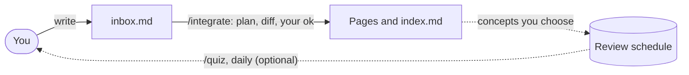

# Recall

A git-native study system for Obsidian.

You write what you learn in one inbox page. `/integrate` moves each block into the page where it belongs, keeps an index of the concepts each page explains, and shows every change as a git diff for you to approve. An optional daily quiz then asks about the concepts you chose to remember, on a spaced-repetition schedule.



## The model and the script

Recall is a set of commands, agents and hooks around a language model, plus one Python script. The work is split between the model and the script. The model does what needs language: it decides where a note goes, writes it into the page, links it, asks questions and judges answers. `scripts/srs.py`, a single file that uses only the standard library, does what has to be exact: the review schedule and every date in it, the daily list of questions, the checks on the index, the parsing of the inbox, and all of git. Each command starts from the script's output, so the model is handed today's list instead of being asked to work it out.

The line isn't left to the prompts alone:

- a hook runs before every edit the model makes, denies the ones under `.srs/`, where the schedule, the log and the seals live, and records each note the model writes, so the script knows exactly what a session changed;
- the agents that index, audit and judge pages get read-only tools (Read, Glob and Grep);
- nothing is committed without your approval of its diff, except in agent review (below), where the script's checks and the judges stand in for you after you approve the plan.

## Git as the review screen

The model writes its proposal straight into your files. `srs.py diff` shows the change, your approval turns it into a commit, and a rejection restores the files from git. Because the review is the diff, it doesn't depend on the session's permission settings. A commit takes only the files the session touched, so what you edit in Obsidian meanwhile waits for a commit of its own. Each operation is one commit, with its notes, index and schedule together. The history reads as a study journal, and `git revert HEAD` undoes the last operation, schedule included:

```text
quiz: 17/20
integrate: queue 3 concepts
integrate: Bayes nets
integrate: Eigenvalues of triangular matrices
vault: manual edits
```

## A day with Recall

### Writing

As you study, you add blocks to the end of `inbox.md`, each under a `##` heading:

```markdown
## Eigenvalues of triangular matrices
The eigenvalues of a triangular matrix are its diagonal entries,
because det(A − λI) is the product of the (a_ii − λ).
```

### Integrating

`/integrate` plans the whole batch before writing anything. The model reads the blocks, groups them by subject, looks up in the index the pages that could take each group, and reads those pages and no others. The plan is a short numbered list: the page for each group, or a new page and its folder, with the blocks in didactic order. A concept that can be defined without the page's subject is split off to a page of its own subject, with a link left in its place. You answer `ok` or adjust the plan.

Then it goes block by block, groups from the newest to the oldest. The model writes each block where the plan puts it, keeps your wording, and marks anything of its own with a `> [!claude]` callout. A factual error in your text stays, and is pointed out in the chat instead of being fixed silently. You see the diff:

```diff
--- a/Math/Eigendecomposition.md
+++ b/Math/Eigendecomposition.md
@@ -9,6 +9,9 @@
 ## Eigenvalues
 The eigenvalues of A are the roots of det(A − λI) = 0.
 
+The eigenvalues of a triangular matrix are its diagonal entries,
+because det(A − λI) is the product of the (a_ii − λ).
+
 ## Diagonalization
 A is diagonalizable when it has n independent eigenvectors:
 A = PDP⁻¹, with the eigenvalues on the diagonal of D.
```

You approve it, ask for a change, skip the block or stop. With the quiz on, the run ends with one list: the concepts it touched, each with a suggestion to put it in the quiz or only keep it in the index.

The index is a Markdown page that lists, for each page, the concepts the page explains:

```markdown
## [[Eigendecomposition]]
- Eigenvectors
- Eigenvalues
- Spectrum (linear algebra) — the set of a matrix's eigenvalues
```

Each concept has one owner page and a unique name, and is the size of a glossary entry. The index is how the model finds where a note belongs without reading the vault, and the catalog the quiz draws from. It is plain text so that you can read and edit it in Obsidian and the script can check every change to it: a repeated name, a link that doesn't resolve, a description over the length limit. The whole index goes into the context of `/integrate`. That suits a personal vault; a much larger one would need retrieval instead.

### Agent review

Approving every diff is the default. With `integrate_review` set to `agent`, you approve the plan, and then each block is checked and committed without you:

1. The script runs the checks that need no model: it repeats the index warnings, requires every new link to resolve, and allows changes to existing text only on pages the plan names.
2. The judges read the block, the plan and the diff from a file the script prepared; the model that wrote the block only passes them its path. `diff-judge` (Haiku) checks that your wording was kept, that the block sits where the plan says, that an error in your text was kept rather than silently fixed, and that every rewrite is in the plan. `concept-judge` (Sonnet) checks that each new concept is on the page that owns it, duplicates nothing in the index and has its index line. It runs only when the script sees that the block adds a heading or a concept.
3. The judges answer in a fixed format that the script parses, and a hook saves each verdict to a file as the judge finishes, so a verdict never passes through the model that wrote the block.
4. On REVISE, the writer gets one revision, and may disagree if it says why. The script's checks run again; the judges don't.
5. A block that fails, or whose verdict never arrives, is set aside as a patch, and you review it with the usual diff at the end of the run or another day. A missing verdict never counts as a pass.

The verdicts go into the commit message:

```text
integrate: Bayes nets

Reviewed by agents.
diff-judge: PASS
concept-judge: REVISE (I) — writer: added Bayes net to the index entry of Probability
```

### The quiz

The quiz is optional: `/setup` asks whether you want it, and `/config` turns it on or off. `/quiz` asks about the concepts that are due, 20 a day at most by default, with one question per concept. Each question comes from the concept's page, not from the model's general knowledge, and asks you to recall, never to choose:

```text
Question 4/12
In probability, what kind of graph is a Bayes net, and what do its edges stand for?

> a directed graph of dependencies between the variables

Fail: the graph must be acyclic. Expected: a directed acyclic graph whose
edges are conditional dependencies. Page: [[Bayes nets]].
```

The model judges the answer, and `srs.py record` applies it to the schedule and the log. Two algorithms are built in: Anki's classic one (SM-2) with Anki's default options, and `thirds`, which has no ease factor and keeps a third of the interval after a lapse. Every number in them is a setting. A fail also records the idea you missed, called a gap, and the concept's next questions aim at that idea until you get it right at least three days later. Gaps change what is asked, never when.

The quiz tests your notes as well as your memory. A concept you keep failing, or an idea you keep missing, points to a page that doesn't work for you, and `/maintenance` lists both. Other problems need only a reading of the page: a page too thin to ask about one of its concepts, or a concept defined on the page of another subject. The quiz notices those only on the pages of the concepts that are due, so `/maintenance` looks for them on every page it audits. Without the quiz, those checks remain; the evidence that comes from your answers doesn't.

### Maintenance

`/maintenance` starts with the script's checks: pages over the size limit, names used twice, links that don't resolve, scheduled concepts missing from the index, pages not yet indexed. Then a Haiku agent reads up to 20 pages and judges each one against its index entry: every listed concept is explained, nothing important is missing, and no concept duplicates another page's under a different name. It also notes thin pages and misplaced concepts, which become flags without failing the page. A page that passes gets a seal, which stores the git hash of the page and a hash of its index entry. Any edit breaks the seal, whether it comes through Recall or from Obsidian, without anyone having to remember to remove it, so each run audits only what changed.

When you open a session in the vault, a hook prints what is waiting, without calling the model:

```text
Recall: today 22 questions: 15 reviews, 7 new concepts
  /quiz        take today's quiz
  /integrate   2 blocks in the inbox: MLflow, Bayes nets
  /maintenance 6 pages changed since the last check (12 days ago)
```

## Cost and speed

- Haiku does the bulk reading: indexing pages during `/setup`, auditing them in `/maintenance`, judging diffs. Sonnet judges concepts, and only on blocks that add one.
- In agent review the script's checks come first, and a block that keeps failing them is set aside without a judge being called.
- The welcome message costs no tokens: the hook runs the script, which only reads the vault's files. It takes about 0.4 seconds on a vault of 150 pages.
- With more than 10 questions left in a quiz, a fork of the session drafts the later questions while you answer the first ones.

## Tests

The script's tests run it against temporary git repositories: both scheduling algorithms step by step, the daily list, sessions that were interrupted, the guard's decisions, the parser of the judges' replies and the hook that saves them. Nothing in the script is random. The spread of intervals comes from the concept's name and the day, and every command takes `--today`, so a test can replay any day. The prompts are a different matter. The tests only check that they agree with the script (the example reply in each judge's prompt has to parse as a valid verdict, for instance); how well the model follows them is learned from use.

## Not measured yet

- Whether the judges catch real problems, and how often they fail a good block. Every committed block carries its verdicts, so after a month of use the git log will show how often a judge asked for a revision, and whether the concept judge is worth its Sonnet cost.
- Whether the auditor's notes on thin pages and misplaced concepts match what the quiz finds on the same pages.
- The scheduling parameters. Both algorithms run on their default values, and `srs.py stats`, which reports retention for calibration, needs a month or more of reviews.
- Native Windows. Recall targets macOS, Linux and WSL.

## Install

You need [Claude Code](https://code.claude.com/docs/en/overview), git, Python 3.8 or later, and an Obsidian vault or any folder of Markdown files.

In Claude Code, opened in your vault:

```text
/plugin marketplace add jeantotola/obsidian-recall
/plugin install recall@obsidian-recall
```

Choose the **project** scope, so Recall's commands and hooks load only in this vault. Then run `/setup`. It asks a few questions (the languages, the paths, what to exclude, whether you want the quiz and, if so, which scheduling algorithm), creates the inbox and the index, and turns the vault into a git repository if it isn't one. Run `/setup` again until your existing pages are indexed: each round indexes 20 pages with a Haiku agent, and you approve the result by diff.

## Commands

| Command | When | What it does |
| --- | --- | --- |
| `/integrate [n \| file]` | After studying | Plans where the inbox blocks go, then integrates them with one diff and one commit per block |
| `/quiz` | Daily, with the quiz on | Asks about the concepts that are due |
| `/promote [page or topic]` | With the quiz on | Adds concepts from notes you already had to the quiz |
| `/maintenance` | Now and then | Checks the pages against the index, seals the ones that pass and reports the rest |
| `/setup` | Once, then until your pages are indexed | Configures the vault and indexes its existing pages |
| `/config [change]` | When your pace changes | Shows or changes the quiz, its daily pace and who reviews `/integrate` |

If another plugin uses the same name, type `/recall:quiz` and so on.

## Documentation

- [docs/usage.md](docs/usage.md): the manual, with the inbox format, the index, the folder map, the welcome message, what gets committed, scheduling and every setting.
- [docs/design.md](docs/design.md): the full rules, with the reasons for them.
- [docs/scheduling.md](docs/scheduling.md): the two algorithms, exactly, and how to add one.

## Repository

```text
scripts/srs.py        the engine: schedule, checks, inbox and git
skills/               the six commands
agents/               index-drafter and page-auditor (Haiku, read-only); diff-judge (Haiku) and concept-judge (Sonnet), read-only too
hooks/                guard.py and the registration of the hooks
rules.md              rules every command follows
templates/            starting files for a vault
docs/                 the manual, the design and the scheduling algorithms
tests/                unit and git-flow tests
```

To work on it:

```text
python3 -m unittest discover -s tests -v
claude plugin validate .
claude --plugin-dir .
```

The last command loads the plugin from this folder for one session, without installing it.

## License

MIT, see [LICENSE](LICENSE).
