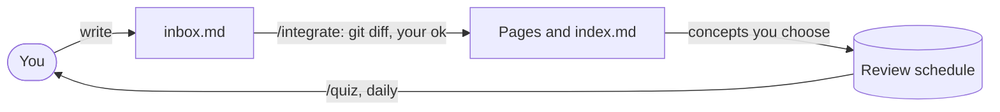

# Recall

**A git-native study system for Obsidian.**

You write what you learn in one inbox page. At the end of a study session, `/integrate` moves it into your vault's pages, block by block, and shows each change as a git diff for you to approve. When the session changed the index, the diff starts with warnings about the lines it added or altered: a description over the limit, a repeated concept name, a link that doesn't resolve or a line that can't be read. They warn; they don't block the commit. An index records the concepts each page explains, and `/quiz` asks you up to 20 questions a day on those concepts, scheduled by spaced repetition (Anki's classic algorithm by default, and every number adjustable). If you prefer, a config key lets judge agents check each block instead, once you have approved the plan, and only the blocks they don't clear wait for you ([Agent review](#agent-review)). A small Python script does the scheduling and all the git work; Claude writes, asks and judges; you approve.

- **Your words stay yours.** Claude moves and links what you wrote, and marks anything it adds.
- **Git is the backbone.** Each operation is one commit, so `git log` reads like a study journal and `git revert` undoes.
- **It fits any vault.** Paths, languages, exclusions and the scheduling algorithm live in one config file.

## How it works



- **Inbox.** One page you write in every day, one block per subject.
- **Index.** For each page, the concepts that page explains. It is how Claude finds where new notes belong without reading the whole vault, and the list of what can be quizzed.
- **Review schedule.** The concepts you chose to remember, each with the date from which it is due. The script computes every date; the model never does.
- **Seals.** `/maintenance` checks pages against the index and seals the ones that pass. Any change to a page breaks its seal, and the seal of a page that was deleted, renamed or excluded is removed automatically.

## Requirements

- [Claude Code](https://code.claude.com/docs/en/overview)
- git
- Python 3.8 or later (standard library only)
- An Obsidian vault, or any folder of Markdown files

Recall targets macOS, Linux and WSL. Native Windows is untested.

## Install

In Claude Code, opened in your vault:

```text
/plugin marketplace add jeantotola/obsidian-recall
/plugin install recall@obsidian-recall
```

Choose the **project** scope, so Recall's commands and hook load only in this vault. Then run:

```text
/setup
```

`/setup` asks a few questions (the language to talk to you in, paths, exclusions, the scheduling algorithm), creates `.srs/`, the inbox and the index, and turns the vault into a git repository if it isn't one. Run `/setup` again until all your existing pages are indexed: each round indexes 20 pages with a small model, and you approve it by diff. Nothing enters the review schedule during setup.

## Quick manual

| Command | When | What it does |
| --- | --- | --- |
| `/integrate [n \| file]` | After studying | Plans where the inbox blocks go, then moves them into your pages with one diff and one commit per block (or, with [agent review](#agent-review), one commit per block the judges clear). Ends with one question: which concepts go into review. |
| `/quiz` | Every day | Asks about the concepts that are due. Answer in your own words. `/config` sets how many questions a day. |
| `/promote [page or topic]` | When you have time | Adds concepts from notes you already have to the quiz, such as what you wrote before Recall. |
| `/maintenance` | Now and then | Checks that your pages match Recall's list of concepts, and reports what needs fixing. |
| `/setup` | Once, then until your notes are covered | Configures the vault and lists the concepts your existing pages explain. |
| `/config [change]` | When your pace changes | Shows or changes how many concepts you get per day, and whether `/integrate` is reviewed by you or by judge agents. You can also just ask for it in the conversation. |

Commands work by their short name when nothing else uses it; otherwise type `/recall:quiz` and so on. When you open a new session in the vault, Recall tells you which of them today calls for ([Welcome message](#welcome-message)).

### A day with Recall

1. **Study and write.** Add blocks at the end of `inbox.md`, each starting with a `##` heading of a few words. A date in the heading is fine.
2. **Run `/integrate`.** It goes in three steps, and each one waits for your answer:
   - **The plan.** Claude groups the blocks by subject and shows where each group goes: an existing page, a new page or sections of one page. Inside a group, blocks follow a didactic order. Answer `ok` or adjust it.
   - **One diff per block.** Claude adds the block at its place in the plan, without rewriting what's already there, and shows you the git diff. Groups run from the newest to the oldest. Approve, ask for a change, skip the block (it stays in the inbox) or stop.
   - **What goes into the quiz.** A final list of the concepts it touched, each with a suggestion: review it, or just keep it on record. Answer `ok` or adjust.

   [The design](docs/design.md#integrate) has the details.
3. **Tomorrow, run `/quiz`.** One question per due concept, asked from its page. When you miss something, Claude notes the idea you missed. It comes back at the end of the session and in that concept's next questions, until you get it right at least 3 days later.

`/integrate 3` processes only the three newest blocks; `/integrate path/to/old-diary.md` integrates another file block by block, the same way.

### Agent review

By default you approve every diff. With `integrate_review` set to `agent` (ask `/config`), `/integrate` still asks you to approve the plan, and then commits each block without showing you its diff, once the block passes two kinds of check:

- **The script's checks**, which cost nothing: the index warnings, links that don't resolve or point to a heading that doesn't exist, and existing text that was rewritten or removed on a page the plan doesn't name.
- **Judge agents that only read.** `diff-judge` (Haiku, always) checks that your wording was kept, that the block landed where the plan says, that an error in your text was not corrected silently, and that every rewrite or move is in the plan. `concept-judge` (Sonnet, only when the block adds a heading or an index concept) checks that each new concept sits on the page that owns it, isn't a duplicate, and is in the index. They return a verdict and never text; Claude reads it, revises once if it agrees, and the judges don't look again.

A block that doesn't pass is set aside with the reason, the other blocks go on, and at the end you choose to look at the set-aside blocks now, with the usual diff, or later: they stay in the inbox, and the welcome message counts them. The final list of concepts for the quiz is still yours. Each commit message lists the verdicts, so `git log` is the audit and `git revert` undoes.

### Welcome message

A new session in the vault starts with a short status, shown directly by a `SessionStart` hook, so it costs no tokens:

```text
Recall: today 22 questions: 15 reviews, 7 new concepts
  /quiz        take today's quiz
  /integrate   2 blocks in the inbox: MLflow, Bayes nets
  /maintenance 6 pages changed since the last check (12 days ago)
```

It shows only what matters: what is left if you stopped mid-quiz, the score once the quiz is done, the next quiz when there is nothing to ask, and an interrupted session as the first line. An empty inbox drops the `/integrate` line. The `/maintenance` line appears only when the command is worth running: with 5 or more pages changed or new since their last check, with any such page 14 days after the last check, or with an idea you keep missing or a leech. A changed page isn't a problem, only a reason to check. The message is in Portuguese when `language` contains "portugu" or starts with "pt", and in English otherwise. It only reads the vault's files: it doesn't run git or write anything. Outside a vault with Recall set up, it prints nothing.

### Inbox format

```markdown
## 2026-10-27 — Eigenvalues of triangular matrices
The eigenvalues of a triangular matrix are its diagonal entries,
because det(A - λI) is the product of the (a_ii - λ).

## Bayes nets
A Bayes net is a directed acyclic graph of conditional dependencies.
```

The heading level is configurable, and headings inside code blocks don't count. Recall never checks or indexes the inbox, so it can grow as large as you like.

### What gets committed

| Commit message | Made by |
| --- | --- |
| `vault: manual edits` | Any command, first, if you changed files in Obsidian since the last commit |
| `integrate: <block title>` | `/integrate`, after your approval of each block; with agent review, after the judges clear it, and the message body lists their verdicts |
| `integrate: queue N concepts` | `/integrate`, after the review question |
| `quiz: 17/20` | `/quiz`, at the end |
| `promote: N concepts` | `/promote` |
| `maintenance: N pages verified` | `/maintenance` (with `, M stale seals removed` when it removed seals; with nothing to change it makes no commit) |
| `setup: ...` | `/setup` |
| `config: new_per_day 5 -> 10` | `/config`, when a value changes |

Undo the last operation with `git revert HEAD`: content, index and schedule go back together.

If a session closes in the middle of a command, the next command shows what was left uncommitted and asks whether to keep or discard it. Discarding only touches the files Claude edited, and removes folders that end up empty after deleting files created in the session.

### Suggestions during /quiz

Claude Code can suggest your next reply in the input line, and during a quiz that suggestion can show the answer. So `/quiz` turns suggestions off in this vault by setting `promptSuggestionEnabled` to false in the vault's `.claude/settings.local.json`, and leaves it off. Recall never commits this file. Other projects keep their own setting.

- Claude Code reads this setting only when it starts. The first time, `/quiz` tells you that suggestions stay on in the current session: turn them off in `/config` (for every project), or restart Claude Code in the vault. From the next session on they are off.
- To have suggestions back in the vault, remove the key from that file.
- If `CLAUDE_CODE_ENABLE_PROMPT_SUGGESTION` is set to true, it overrides this setting, and `/quiz` tells you to turn it off where it is defined.

## The index

```markdown
## [[Eigendecomposition]]
- Eigenvectors
- Eigenvalues
- Reversibility (calculus) — integral and derivative as inverses
```

- One section per page, linked the way Obsidian links it.
- One concept per line. A short description (60 characters by default) only when the name alone is ambiguous.
- A page lists only the concepts it explains. Each concept has one owner page, and names are unique across the index.
- Concepts are glossary-sized: "Eigenvectors", not "Linear algebra".

## The folder map

With `new_page_placement` set to `folders`, `/integrate` picks a folder for each new page. Folder names alone often leave it guessing, so `/setup` drafts `folders.md`, a map of what each top-level folder takes:

```markdown
| Folder | What goes in | What doesn't, and where it goes |
| --- | --- | --- |
| Computer Science | How computing works: algorithms, data structures, networks | Tools and operations (Systems Engineering) |
| Systems Engineering | Building and running software: environments, containers, cloud | How the technology works inside (Computer Science) |

## Tie-breaks

- Computer Science or Systems Engineering? How it works, or how to use it.

## New folders

- New top-level folder: only when at least 3 pages that fit no folder are expected.
```

- One row per top-level folder, its name exactly as on disk in the first column. `/maintenance` reports folders without a row and rows without a folder.
- The map is yours: edit the scopes, the tie-breaks and the rules for new folders, including the 3-page minimum, whenever you like. `/integrate` reads the current file each time.
- When `/integrate` creates a top-level folder, it adds the folder's row to the map in the same diff.
- Run `/setup` again to draft the rows that are missing.

## Scheduling

Answers are pass or fail. Each concept in the schedule has one date, the day from which it is due, and the script computes every date. Two algorithms are built in. `/setup` asks which one to use, and you can switch later in `.srs/config.json`.

| | `anki` (default) | `thirds` |
| --- | --- | --- |
| What it is | Anki's classic scheduler (SM-2) with Anki's default options | Recall's own rules |
| Pass in review | Interval × the concept's ease, 2.5 to start | Interval × 2.5 |
| Fail in review (a lapse) | Ease − 0.2, never below 1.3. After the next pass the interval restarts at 1 day | After the next pass the interval is a third of what it was |
| Another fail while relearning | Back the next day, no extra penalty | A third of that third, down to 1 day |
| Spread of intervals | Anki's fuzz: about ±1 day at 3 days, ±3 at 20, ±7 at 100 | Up to ±5% from 3 days on |
| Leech | 8 lapses | 10 lapses, counting fails while relearning |

Both share the rest:

- A new concept graduates on its first pass and comes back the next day; a fail brings it back the next day too.
- With no lapses, both give about 1, 3, 8, 20, 50, 125 and 313 days.
- A late review counts half the delay: a 10-day interval answered 10 days late grows from 15 days instead of 10.
- A failed concept comes back the next day. The same-day repeat in `/quiz` is practice and isn't recorded.
- A fail also records the idea you missed, called a gap. The concept's next questions test that idea until you pass it at least 3 days after the previous answer, and then the gap disappears. Gaps change what is asked, never the dates. `/maintenance` lists the ones that won't close.
- A contested verdict is corrected with `srs.py amend "<Concept>" pass|fail`, on the same study day only. The concept goes back to how it was before the answer and the answer is applied again with the new result; the next day, the answer is final.
- New content for a concept in review brings it back the next day with a question on the new part. A pass keeps the interval; a fail is a normal lapse.
- Up to 20 concepts a day: learning, relearning and updated concepts first, then reviews (most overdue first), then new concepts, at most 5 a day and only if there is room.
- A new concept waits until the next day. The study day starts at 4 a.m., so a late-night session counts as the same day.
- Fuzz comes from the concept name and the day, so the same answers always give the same dates.

**Which one?** `anki` is the familiar baseline. With only pass and fail, though, an Anki ease can only go down, so a concept that lapsed a few times grows slowly for good: Anki's "ease hell". `thirds` has no ease. A lapse costs part of the interval once, and the concept then grows at the normal pace again.

**Make it yours.** Every number above is a parameter in `.srs/config.json` (see [Configuration](#configuration)); changes apply from the next answer. [docs/scheduling.md](docs/scheduling.md) has the exact formulas and shows how to add an algorithm of your own.

To check retention, run `python3 <plugin folder>/scripts/srs.py stats` in the vault. It splits the reviews of the last 30 days into young (interval under 21 days) and mature (21 days or more), each with its count, plus the combined rate; a group with fewer than 30 reviews shows "not enough data". Calibrate on mature retention once it has enough reviews, and on young retention until then. Aim for 85 to 90%. If you are far from it, adjust `interval_modifier` (anki) or `multiplier` (thirds).

## Configuration

`/setup` writes `.srs/config.json` in your vault. Use `/config`, or just ask, to change `scheduling.daily_limit`, `scheduling.new_per_day` and `integrate_review`; edit the file by hand for the rest.

| Key | Default | Meaning |
| --- | --- | --- |
| `language` | asked by `/setup` | Language Claude talks to you in |
| `concept_language` | `English` | Language of concept names and index descriptions |
| `paths.inbox` | `inbox.md` | Inbox page |
| `paths.index` | `index.md` | Index page |
| `paths.new_pages` | `wiki` | Fallback folder for new pages: where they go with `flat`, or when the vault has no thematic folders |
| `paths.folder_map` | `folders.md` | Folder map: what each top-level folder takes, used by `/integrate` with `folders` |
| `new_page_placement` | `folders` | `folders`: `/integrate` puts a new page in the existing folder whose topic fits best, or proposes a new folder in the vault's naming style. `flat`: every new page goes in `paths.new_pages` |
| `inbox_heading_level` | `2` | Heading level that opens an inbox block |
| `integrate_review` | `human` | `human`: you approve each diff of `/integrate`. `agent`: you approve the plan, then the script's checks and the judge agents decide each block, and you supervise only the blocks they send back |
| `exclude` | `[]` | Patterns to ignore: `folder/`, `*.excalidraw.md`, `Daily/*.md` |
| `scheduling.algorithm` | `anki` | `anki` or `thirds` |
| `scheduling.daily_limit` | `20` | Concepts per day, reviews and new concepts together |
| `scheduling.new_per_day` | `5` | New concepts per day, in the slots reviews leave free. None enter on a day when due reviews exceed the daily limit |
| `scheduling.day_starts_at` | `4` | Hour the study day starts |
| `scheduling.mature_interval` | `21` | Days of interval from which `srs.py stats` counts a review as mature |
| `scheduling.anki` | Anki's defaults | Parameters of `anki`, below |
| `scheduling.thirds` | Recall's defaults | Parameters of `thirds`, below |
| `limits.page_max_chars` | `6000` | Page size checked by `/maintenance` |
| `limits.description_max_chars` | `60` | Length of index descriptions |
| `limits.maintenance_batch` | `20` | Pages audited per `/maintenance` |
| `limits.setup_batch` | `20` | Pages indexed per `/setup` round |

Parameters of `anki`, under `scheduling.anki`. The defaults are Anki's own.

| Key | Default | Meaning |
| --- | --- | --- |
| `graduating_interval` | `1` | Days until the review after a new concept's first pass |
| `starting_ease` | `2.5` | Ease a concept starts with: what a pass multiplies the interval by |
| `ease_penalty` | `0.2` | Ease lost on each lapse. `0` keeps every concept at the starting ease |
| `minimum_ease` | `1.3` | Floor for the ease |
| `interval_modifier` | `1.0` | Scales every passing interval: below 1 for more reviews, above 1 for fewer |
| `hard_interval` | `1.2` | Anki's Hard multiplier. With pass and fail only, it just sets the minimum growth of a pass |
| `new_interval` | `0.0` | Share of the interval kept after a lapse (Anki's "New interval") |
| `minimum_interval` | `1` | Days, the floor for the interval after a lapse |
| `maximum_interval` | `36500` | Days |
| `fuzz` | `true` | Anki's spread of intervals |
| `leech_threshold` | `8` | Lapses that flag a leech |

Parameters of `thirds`, under `scheduling.thirds`:

| Key | Default | Meaning |
| --- | --- | --- |
| `multiplier` | `2.5` | Interval growth on a pass |
| `lapse_divisor` | `3` | Interval cut on a lapse, and again on each fail while relearning |
| `min_interval` | `1` | Days, the floor for any cut |
| `fuzz` | `0.05` | Spread of intervals, either way; `0` turns it off |
| `fuzz_min_interval` | `3` | Days; shorter intervals are never spread |
| `leech_threshold` | `10` | Lapses that flag a leech |

The quiz rules live in `.srs/quiz-rules.md`, as plain text you can edit. Recall always ignores the inbox, the index, the folder map, `CLAUDE.md` files and hidden folders such as `.obsidian/`, `.trash/`, `.claude/` and `.srs/`.

## Files

In your vault:

```text
your-vault/
├── inbox.md
├── index.md
├── folders.md            folder map
├── wiki/                 new pages
├── ...                   your pages, wherever they are
├── .gitignore            Recall adds .srs/session.json, .srs/review/ and Obsidian's workspace files
└── .srs/
    ├── config.json
    ├── quiz-rules.md
    ├── state.json        review schedule
    ├── verified.json     seals
    ├── log.csv           one line per answer
    ├── review/           agent review: the plan, the judges' verdicts, blocks waiting for you (never committed)
    └── session.json      the command in progress (never committed)
```

In this repository:

```text
obsidian-recall/
├── .claude-plugin/       plugin and marketplace manifests
├── skills/               setup, integrate, quiz, promote, maintenance, config
├── agents/               index-drafter and page-auditor (Haiku, read-only); diff-judge (Haiku) and concept-judge (Sonnet), read-only too
├── hooks/                guard.py and the registration of the hooks
├── scripts/srs.py        the engine
├── templates/            starting files for a vault
├── rules.md              rules every command follows
├── docs/design.md        the full design
├── docs/scheduling.md    the scheduling algorithms, exactly
└── tests/                unit and git-flow tests
```

## How the pieces fit

- **The script decides.** `srs.py` computes every date and the daily list, checks the index, parses the inbox and runs git. Each command injects its output before Claude reads the command, so the daily list arrives ready.
- **Claude writes, asks and judges.** It integrates your notes, asks questions from each concept's page, and judges answers strictly. You can contest a verdict: if you do, Claude runs `srs.py amend` and the answer is corrected on the spot, in the schedule and in the log.
- **The hook keeps both in their lanes.** It blocks direct edits to `.srs/`, lets Claude edit notes without prompts only while a command is open (recording each file for the diff), and lets the plugin's own script run without permission prompts. Because the review is the git diff, it works the same in every permission mode. A second hook shows the welcome message when a new session starts, and a third saves the judge agents' verdicts to a file, so a verdict never passes through the agent that wrote the block.
- **Cheap agents read in bulk.** Indexing and auditing pages run in Haiku subagents that can only read. In agent review, the diff judge runs on Haiku, and the concept judge on Sonnet and only when a block adds a concept.
- **Long quizzes are prepared ahead.** With more than 10 questions left, a background fork of the session (same model) drafts the questions from the fourth on while you answer the first ones.

## Development

```text
python3 -m unittest discover -s tests -v
claude plugin validate .
claude --plugin-dir .
```

The last command loads the plugin from this folder for one session, without installing it.

## License

MIT, see [LICENSE](LICENSE).
